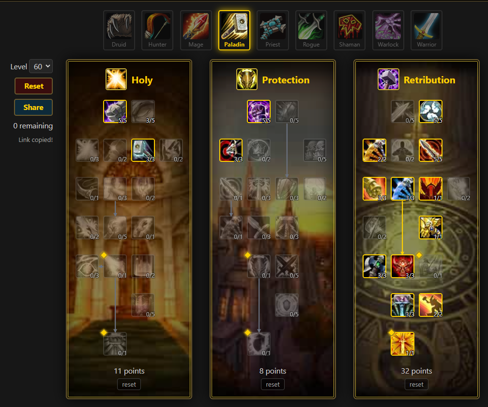
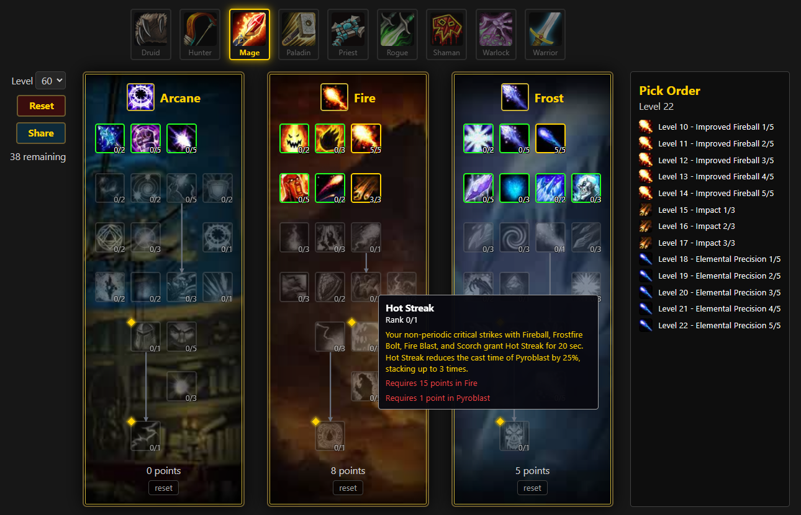

# WoW Forever Tools - Talent Calculator

Talent calculator and build planner for **WoW Forever** (Classic, level 60 / 51
talent points). Plan, preview and share builds for all **9 classes**, each with
its 3 classic 7×4 talent trees, WoW-style artwork, icons and tooltips.

Open `/{class}` in the browser, for example `/paladin`, `/warrior`, `/druid`,
`/hunter`, `/mage`, `/priest`, `/rogue`, `/shaman` or `/warlock`, and start
clicking talents.

## Screenshots


*The 3 trees sharing the 51-point pool, with per-tree counters.*


*Verbatim rank tooltip with Next Rank + the pick-order list (Level 10, 11, ...).*

## What it does

- **Interactive trees** (`resources/js/calculator.js`): 3 side-by-side 7×4
  grids sharing one 51-point pool, with per-tree counters and a remaining-points
  counter. Left-click adds a point, right-click removes one.
- **Classic rules enforced in JS**: per-talent cap, 51-point pool, row gate
  (`(R-1)*5` points in rows above), prerequisites must be maxed (for example
  Illumination <- Reverence), and removal is simulated before it is accepted.
- **WoW-style presentation**: official Blizzard tree artwork as background,
  bronze/gold frames, spec icons, talent icons from `wow.zamimg.com`, and a
  tooltip with verbatim rank text plus `Next Rank` while skilling.
- **Pick-order panel**: one line per spent point in learn order
  (`Level 10 - Divine Strength 1/5`, ...). The header shows the character level
  (9 + spent points; 51 points = 60). Removing a point drops that talent's most
  recent pick, so the list is always a valid sequence.
- **Level selector (10-60)**: caps the pool to `level - 9` points to plan
  leveling builds. Lowering the level trims picks from the end; reset restores
  60.
- **Shareable builds**: the URL carries the pick order
  (`/{class}?b={code}[&level=N]`) as base64url 6-bit talent indices. There is no
  storage, so identical builds share identical links. Opening a link replays
  the picks through the same rules, so tampering cannot produce an illegal
  build.
- **Class bar**: all 9 Forever classes across the top; the current one glows
  gold.
- **JSON API** for every class (see Routes below).

## Routes

| Method | Path | What |
|---|---|---|
| `GET` | `/{class}` | Calculator page (`App\Http\Controllers\ClassController@show`), 404 when the slug is not seeded |
| `GET` | `/api/classes/{slug}` | Class + ordered trees + talents by row/col, including `background`, `spec_icon`, `ranks` and `skill` (`Api\WowClassController`) |

The production site is the static export, not these Laravel routes. The exporter
renders the same pages to `dist/`.

## Tech stack

Laravel 13, PHP 8.3, SQLite (local), Vite 8, Tailwind CSS 4, vanilla JS (no SPA
framework). PHPUnit covers data integrity and the static export; Vitest covers
the pure JS rules and URL codec.

## Quickstart

```sh
composer install
cp .env.example .env
php artisan key:generate
php artisan migrate --force
php artisan db:seed --class="Database\Seeders\ForeverClassSeeder" --force
npm install
npm run build
php artisan test
npm test
```

Shortcut (install + migrate + build):

```sh
composer setup
```

Then visit `http://localhost:8000/paladin` (serve with `php artisan serve` or
`composer dev`).

## Static export

Production needs no PHP and no database:

```sh
npm run build
php artisan forever:export dist
```

The exporter writes `{class}.html` and `{class}.json` for all 9 classes, a
minimal class picker `index.html`, the Vite bundle, and `.nojekyll`. It moves a
stale `public/hot` aside while rendering so `@vite` emits manifest tags, never
dev-server tags. `.github/workflows/pages.yml` builds and deploys `dist/` to
GitHub Pages on every push to `main`.

## Data pipeline

The talent data is manifest-driven, not hand-written per class:

1. `php artisan forever:import {class}` (`App\Console\Commands\ImportForeverClass`)
   downloads the wowtbc.gg `page-data.json` for the class, writes
   `database/data/{class}_{tree}.json` with verbatim `ranks[]` and `skill`
   blocks, resolves icons against Wowhead Forever data, probes artwork
   backgrounds and merges `database/data/classes.json`. Spec icons are filled by
   hand after a zamimg 200-check.
2. `Database\Seeders\ForeverClassSeeder` loads everything from
   `database/data/classes.json` with scoped slugs and a second pass for
   prerequisites.
3. `GET /api/classes/{slug}` serves the DB content; `calculator.js` renders it
   generically (the API URL comes from `#trees data-api`).

Key files:

| File | Role |
|---|---|
| `database/data/classes.json` | Class manifest: trees, data files, backgrounds, spec icons |
| `database/data/*_{tree}.json` | Source of truth per tree (row/col/slug/max_rank/requires_slug/status/description/ranks/skill/icon) |
| `database/seeders/ForeverClassSeeder.php` | Manifest-driven seeder for all classes |
| `resources/js/calculator.js` | Calculator entry point: DOM, tooltip, arrows, pick order, level selector |
| `resources/js/calculator/rules.js` | Pure rules: pool, row gate, prerequisites, removal, level cap |
| `resources/js/calculator/codec.js` | Pure `?b=` encoder/decoder |
| `resources/views/calculator.blade.php` | Generic `/{class}` view: class bar + `#trees` slot + pick-order panel |
| `app/Console/Commands/ForeverExport.php` | `php artisan forever:export [dist]`: static no-backend site |
| `docs/brief.md` | Public site scope, phases and constraints |
| `docs/runbook.md` | Execution order, models and prompts |
| `docs/calculator.md` | Build notes: scraping source, rules, icon/presentation status |

## Documentation

- `docs/brief.md`: what the public site is and is not.
- `docs/architecture.md`: data flow and static export.
- `docs/data-policy.md`: sourcing and verification rules.
- `docs/roadmap.md`: current phase and next steps.
- `docs/agents.md`: agent roles and review workflow.
- `docs/runbook.md`: model per step and copy-paste prompts.
- `docs/calculator.md`: historical calculator notes.

## Attribution

Talent data (c) wowtbc.gg / Blizzard. Icons (c) Blizzard via
`wow.zamimg.com` (short names only, hotlinked with text fallback). Tree artwork
hotlinked for educational use. See `docs/calculator.md` for the full scraping
and verification notes.
